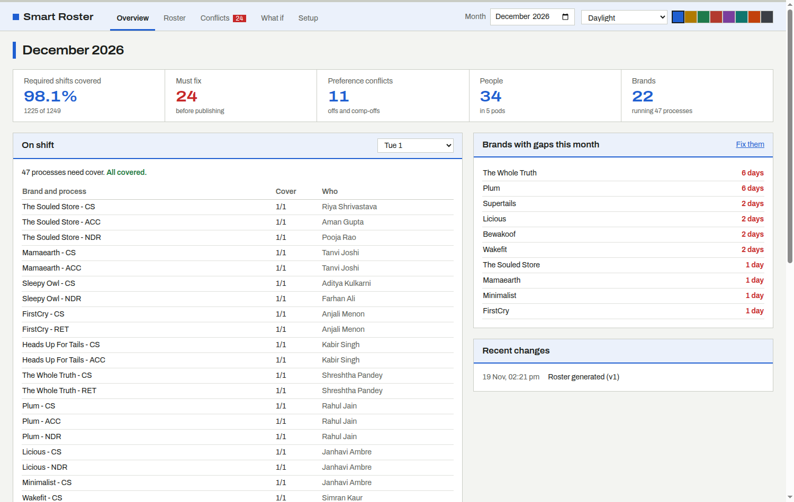
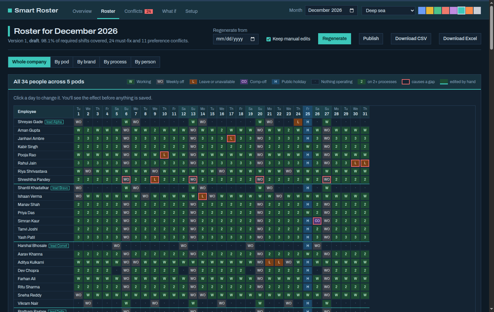
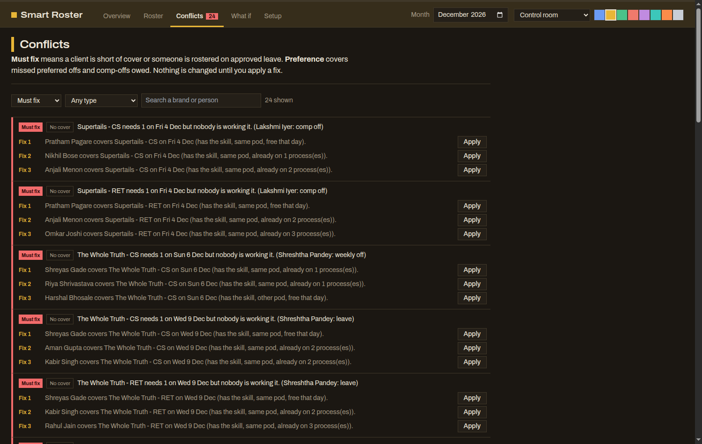
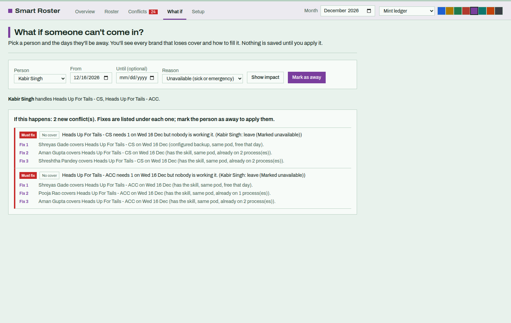
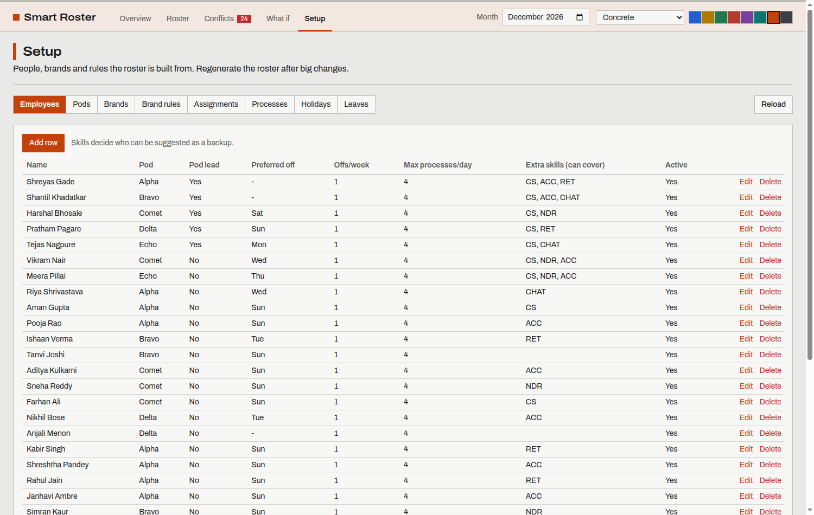

# Smart Roster Management System

A browser-based tool that helps an operations manager **plan, generate, validate and manage monthly rosters**
for 34 employees across 22 brands, 5 processes and 5 pods.

**Author:** Shreyas Gade · [LinkedIn](https://www.linkedin.com/in/shreyas-gade-756379269)

## Screenshots

| | |
|---|---|
| **Overview** (Daylight, Signal blue): coverage, must-fix count, who is on shift on any day |  |
| **Roster** (Deep sea, Harbour teal): every person and day, grouped by pod, with gaps outlined |  |
| **Conflicts** (Control room, Railway yellow): plain-English problems with ranked, pre-tested fixes |  |
| **What if** (Mint ledger, Plum): one person's absence, the gaps it causes, and how to fill them |  |
| **Setup** (Concrete, Saffron): people, brands, rules and assignments, editable without code changes |  |

- **Backend:** Python 3.12, FastAPI, SQLAlchemy, SQLite. The scheduler is pure Python and unit tested.
- **Frontend:** React 18, Vite, TypeScript, Tailwind CSS.
- **Deployment:** FastAPI serves both the API (`/api/...`) and the built React app, so it runs as one service.

## Run locally

```bash
# backend
python3 -m venv .venv
.venv/bin/pip install -r backend/requirements.txt
cd frontend && npm install && npm run build && cd ..   # build the UI once
cd backend && ../.venv/bin/uvicorn app.main:app --reload --port 8000
```
Open http://localhost:8000. API docs: http://localhost:8000/docs.

On first start the database is created and seeded, and the December 2026 roster is generated.
To reset everything, delete `backend/roster.db` and restart.

For UI development with hot reload, run `npm run dev` in `frontend/` (it proxies `/api` to port 8000).

Tests: `.venv/bin/pytest backend/tests`

## Project structure

```
backend/app/
  scheduler/        pure scheduling logic (no database)
    types.py        data classes
    calendar.py     operating calendars, presets, required staff per day, weeks
    generator.py    builds the roster (leaves -> holidays -> weekly offs -> backups)
    validator.py    coverage + all conflict checks, before/after diff
    suggestions.py  ranked fixes for each coverage gap
  services/         database <-> scheduler (loader.py, roster_service.py)
  routers/          crud.py (generic setup endpoints), rosters.py (roster endpoints + export)
  seed/             sample data
frontend/src/
  pages/            Dashboard, Roster (5 views), Conflicts, Change simulator, Setup
  components/       RosterGrid, CoverageGrid, ConflictList, CellEditor, CrudTable
```

## Features

- **Setup:** add, edit or delete employees, pods, pod leads, brands, processes, brand rules, assignments
  (PRIMARY or BACKUP), skills, holidays and leaves. No code changes are needed.
- **Brand rules:** each brand-process has its own operating calendar (365 days / every day except public
  holidays / Sundays and public holidays off / custom weekdays), a minimum staff number, per-weekday or
  per-date overrides, and a shift.
- **Generation:** a whole month in about a second. You can regenerate from a given date while keeping
  manual edits.
- **Views:** company, pod (with pod lead), brand, process and employee. Each view has an employee-by-day
  grid, a daily coverage grid (`working/required`) and the conflicts that apply to it.
- **Conflicts:** HARD (coverage gap, understaffing, working on approved leave, shift clash),
  SOFT (preference ignored, missing weekly off, overload, holiday worked so a comp-off is owed) and
  INFO (one person's absence hits several brands, pending leave).
- **Suggestions with one-click Apply:** move a weekly off, use the configured backup, or use a skilled
  colleague (same pod first, least busy first). Each suggestion is simulated before it is offered.
- **Manual edits:** click any cell, check the impact, then save.
- **Change simulator:** mark someone unavailable after the roster is generated, preview the impact across
  all their brands, then apply the change and a fix.
- **Publish:** blocked while HARD conflicts exist, unless you explicitly override. Editing a published
  roster sets it back to DRAFT. Every change is recorded in a change log.
- **Export:** CSV and colour-coded Excel.
- **Themes:** 5 light themes (Daylight, Drafting, Concrete, Mint ledger, High contrast) and 5 dark themes
  (Night shift, Control room, Deep sea, Carbon, High contrast dark), each with 8 accent colours. The choice is saved in the browser. A link can also set it, for example
  `/roster?theme=night&accent=pine`.
- **Shareable what-if links:** `/simulator?person=Kabir Singh&from=2026-12-16` opens with that scenario
  already checked.

## Assumptions

1. Each employee gets 1 weekly off per Mon–Sun week (configurable per employee). A week belongs to the
   month that contains its Sunday, so the partial week at the end of a month is counted in the next month.
2. Employees get public holidays off unless a 365-day process they run would be left uncovered. In that
   case they work and are owed a comp-off, which is shown as a SOFT conflict.
3. One person can handle several brand-processes on the same day, up to `max_parallel_processes`
   (default 4).
4. Shifts are labels. MORNING and EVENING on the same day clash; GENERAL clashes with nothing.
5. Only APPROVED leaves affect the roster. PENDING leaves are shown as INFO.
6. Coverage minimums are hard constraints. Preferred off days and fairness are soft.
7. Weekly offs are a labour rule and are always given. If an off cannot be placed without leaving a
   gap, the gap is flagged with fixes instead of the off being silently removed.
8. A BACKUP assignment means the manager has pre-approved that person to cover. The generator uses
   backups automatically; any other cover is only suggested.
9. Brand names are well-known Indian D2C brands, used only to make the sample data easy to read. There is
   no affiliation, and all staffing data is made up. The demo months are December 2026 and January 2027.

## Tell us how you think

**1. How did you model employees, brands, processes, pods and their relationships?**
`Pod → Employee` (one employee is flagged as pod lead). `Brand → BrandProcess`: a brand running one
process. The operating rules live on BrandProcess, so a brand's CS can run 365 days while its NDR is off
on Sundays. `Assignment` links an Employee to a BrandProcess with role PRIMARY or BACKUP. This one table
covers single-resource brands, people working several brands, and several people sharing one process.
Employee `skills` list processes a person can cover even if not assigned. The roster is stored as one
`RosterEntry` per employee per day (status plus the brand-processes worked). This keeps the brand's
operating calendar separate from the employee's schedule.

**2. How does your system generate a roster and check the constraints?**
A deterministic greedy algorithm (`scheduler/generator.py`):
1. Keep locked or manual entries.
2. Apply approved leaves and comp-offs.
3. Everyone starts as working on the processes that run that day.
4. Public holidays are given off when coverage allows.
5. Weekly offs: for each person, least flexible first (single-resource owners), every day of the week
   is scored. Breaking a coverage minimum costs +1000, a day the person's processes don't run is −50,
   their preferred day is −20, and there are small penalties for Sunday fairness and for overlapping
   with co-workers. The lowest score wins.
6. Configured backups fill any remaining gaps.

After that, `validator.py` independently counts `staffed vs required` for every brand-process and day
and runs every check. Validation runs again on every read, so changes to rules or setup are reflected
immediately.

**3. Single-resource vs multi-employee brands?**
They use the same model and algorithm. The difference comes out of the data. A single owner of a
Mon–Sat brand gets Sunday off at no cost. A single owner of a 365-day process cannot take an off
without leaving a gap, so a configured backup covers it, or the gap is flagged with suggestions. For
shared processes the scoring staggers offs, so two people sharing CS never take the same day off, and
Sundays are shared fairly.

**4. What if the person running every process for a brand is unavailable on a required day?**
Every process of that brand shows a HARD `COVERAGE_GAP` that names the person and the reason. If the
person runs several brands, an INFO conflict groups the impact. Each gap gets ranked suggestions: a
configured backup, then a skilled colleague in the same pod, then one from another pod. Each suggestion
is simulated so it creates no new hard conflict. The manager clicks Apply.

**5. Conflicting requirements or insufficient staffing?**
Nothing is hidden. Hard constraints win over soft ones; for example, a Sunday-off preference gives way
when the client needs 2 people on Sunday. Anything that cannot be satisfied becomes a conflict with a
plain-English explanation and possible fixes. If there is no safe fix, it says so and asks for a
manual decision. Publishing is blocked until HARD conflicts are resolved or explicitly overridden.

**6. What is automated and what stays under human control?**
Automated: generation, coverage counting, conflict detection, impact previews, and finding and checking
fixes. Under human control: applying any non-backup cover, manual edits, approving leave, and
publishing. Moving people across brands affects client relationships and workload, so the system
recommends and the manager decides.

**7. If the team and brands doubled?**
The greedy approach scales roughly linearly and would still run in seconds. I would move to Postgres,
index the coverage counts, compute suggestions on demand instead of for every conflict, and consider a
CP-SAT solver (OR-Tools) to optimise fairness and preferences globally. I would also add
role-based access so pod leads manage only their own pod.

**8. With one more week?**
An approval workflow (pod lead proposes, ops manager approves), notifications when a published roster
changes, side-by-side comparison of alternative plans, and AI-written explanations for complex
multi-brand conflicts.
